  

  

<table align="center" border="0">
  <tr>
    <td valign="top"></td>
    <td valign="top"></td>
  </tr>
  <tr>
    <td valign="top">
      
    </td>
    <td valign="middle" align="center">
      
    </td>
  </tr>
</table>

  

Contribution city adapted from <a href="https://github.com/georgekobaidze/georgekobaidze">Giorgi Kobaidze</a>'s generator, MIT licensed.

