  

  Full-stack engineer building web, mobile, and the infrastructure under them. Currently poking at machine learning and cybersecurity.

<table align="center" border="0">
  <tr>
    <td valign="top">
      
    </td>
    <td valign="top">
      
    </td>
  </tr>
</table>

  

  

